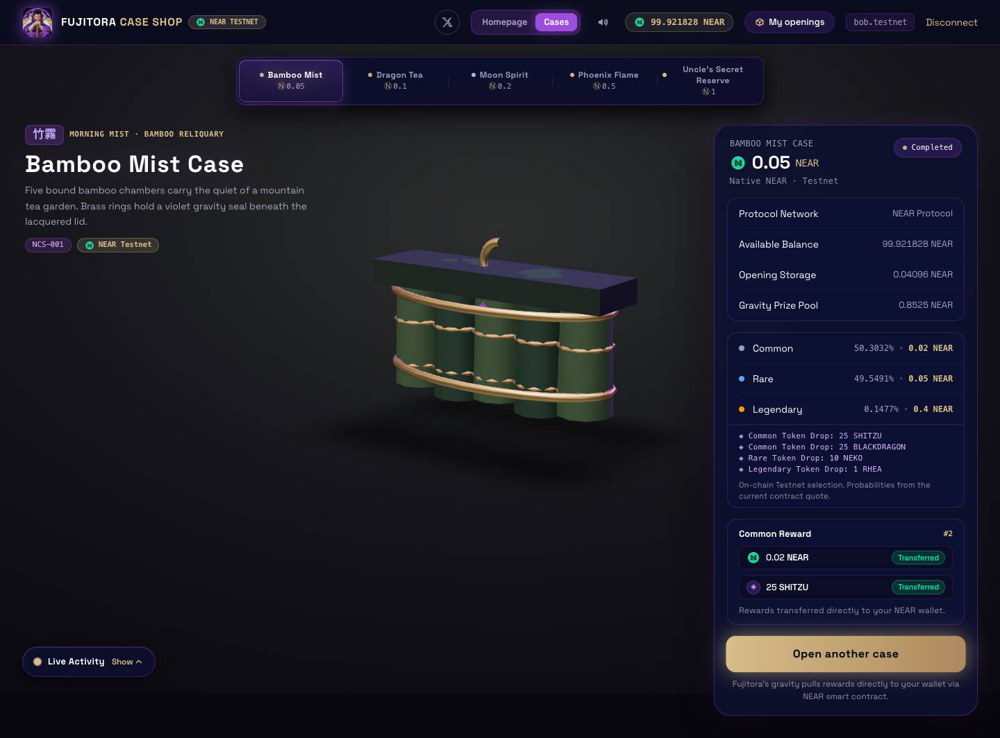
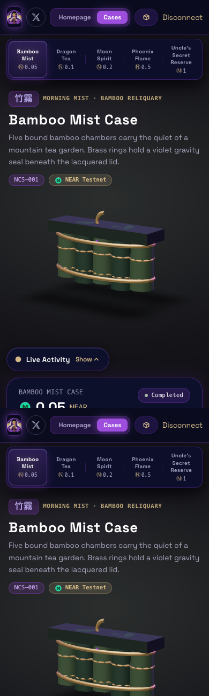

# Fujitora Case Shop

A gravity-inspired case opening experience on NEAR Testnet. Choose a case, pay native test NEAR through your own wallet, and reveal the reward selected by its smart contract. Native NEAR and a configured Testnet token are paid directly to the same account.

[Visit Fujitora Case Shop](https://fujitoracaseshop.up.railway.app/) · [Deployment guide](docs/native-near-deployment.md) · [Verification records](docs/native/evidence/verification.json)

This is a Testnet demonstration. Test NEAR and the configured collectible tokens have no monetary value. The contracts have not undergone an independent security audit.

## The experience

- Five case themes with native NEAR prices and separate reward pools.
- Procedural 3D presentation, on-chain reward reveal, and a timed return to idle.
- A persistent case selector, wallet balance, live probabilities, and purchase controls.
- Personal opening records and global activity from finalized contract views.
- Recovery for interrupted wallet responses, pending randomness, and failed reward transfers.
- A separate homepage background using the Fujitora logo.
- Keyboard navigation, reduced-motion support, and a WebGL fallback.

## Screenshots

The browser verification runner writes these images from its local NEAR Sandbox session. They show test accounts and local chain activity.



<details>
<summary>Mobile Sandbox verification</summary>



</details>

## Five cases

The authoritative prices, payouts, token candidates, and deployed account IDs are in [`config/cases.native.testnet.json`](config/cases.native.testnet.json). All prices below exclude the refundable or consumed storage deposit reported by the live quote, plus transaction gas.

- **Bamboo Mist**, 0.05 NEAR. A bamboo reliquary with gold bindings. Common pays 0.02 NEAR, Rare pays 0.05 NEAR, and Legendary pays 0.4 NEAR.
- **Dragon Tea**, 0.1 NEAR. An armored mechanical chest. Common pays 0.01 NEAR, Rare pays 0.1 NEAR, and Legendary pays 0.5 NEAR.
- **Moon Spirit**, 0.2 NEAR. A lunar vessel inside an armillary frame. Common pays 0.01 NEAR, Rare pays 0.2 NEAR, and Legendary pays 2 NEAR.
- **Phoenix Flame**, 0.5 NEAR. An angular obsidian casket with stepped metal wings. Common pays 0.01 NEAR, Rare pays 0.35 NEAR, and Legendary pays 10 NEAR.
- **Uncle's Secret Reserve**, 1 NEAR. A coopered reserve barrel with metal hoops and a front seal. Common pays 0.2 NEAR, Rare pays 1.5 NEAR, and Legendary pays 12 NEAR.

Each opening also selects one configured Testnet token within its rarity tier. Multiple candidate tokens can share a tier. The contract reserves every possible candidate before accepting an opening.

### Probabilities

The three tiers are Common, Rare, and Legendary. Odds depend on the selected case's available pool balance. Read the current `get_quote` response or the probability panel before purchasing. Every quote uses an integer denominator of 1,000,000, and the three probabilities sum to that denominator.

The contract checks the quote revision, expiry, account nonce, attached deposit, and reserve availability before accepting payment. The frontend animation never chooses the reward. Protocol randomness resolves the accepted opening on-chain, using the odds recorded when it was accepted. This is a Testnet randomness design, not a production VRF or a claim of resistance to validator manipulation.

## Payments, payouts, and recovery

An opening attaches the case price plus its quoted storage deposit in yoctoNEAR. Configuration economics use integer microNEAR, converted at the contract boundary by multiplying by 10^18. The wallet adapter signs a native `FunctionCall`; it does not purchase through an FT transfer.

The existing platform fee is 5% of the advertised case price. The other 95% funds the case pool. There is no extra 5% charge. Fees vest only after both the native reward and the selected token reward have been paid.

The frontend registers the connected account on configured reward tokens when required, using their actual storage bounds. NEAR and token payouts run as separate transfer legs. The contract records success for each leg and retries only unpaid legs. A failed token transfer therefore does not cause a second native payout.

Before wallet confirmation, the browser saves the purchase intent under its account and case contract. If a wallet response is missing, reconnect the same wallet and let finalized history reconcile that nonce. You can verify a known transaction hash or retry the same nonce with a renewed quote. A late original and its retry cannot create two openings. Unknown wallet errors retain recovery information; a proven local preflight failure can release it without submitting a purchase.

Read the [Bamboo Mist diagnosis](docs/native/bamboo-recovery.md) for the verified expired-quote failure and the nonce-preserving fix.

Do not clear browser recovery data to bypass an unknown transaction. Check wallet history and finalized chain state first.

## History

Personal and global records come from finalized contract pagination. They include the case, connected or shortened player account, native price, rarity, opening timestamp, payout status, and reward assets. The UI resolves recent indexer references against finalized RPC transactions, matching signer, contract, nonce, and the returned opening ID before showing a transaction link. It falls back to the opening block when a historical transaction reference is unavailable. History does not invent activity or generate random frontend drops.

The optional Next.js `/api/case-history` route returns third-party indexer references for historical investigation. An indexer reference alone is not a receipt-verified transaction. Native history currently uses the contract's opening records; receipt verification, rather than an indexer status alone, determines whether a purchase link is shown.

## Open Cases. Help Paws. 🐾

The goal is to dedicate the existing platform fee to food and essential supplies for shelter dogs. This would use the 5% already included in a case price.

The deployed native contracts currently retain vested fees and expose no withdrawal method. Charity routing is not active. The dedicated user-controlled treasury is `fujitora-paws.needmore_1_near.testnet`, verified with 0.1 test NEAR of initial account funding. No real donations have been made through this initiative. Test NEAR has no monetary value.

A contract upgrade and owner-authorized activation are required before fee routing can become active. The prepared routing passed all-five-case Sandbox tests, including an upgrade from the prior WASM, failed native transfers, retry, exact receiver balances, and preservation of earlier fees. [Treasury ownership and recovery](docs/charity/treasury.json) use the same existing full-access public key as the owner account. No new private key was generated or exported. Previously accrued fees must remain untouched without separate authorization. A treasury address or fee-transfer claim must appear in the UI only after on-chain verification. See the [current work and authorization record](docs/final-polish-progress.md).

## Architecture and stack

The active application uses React 19, TypeScript, Vite, Tailwind CSS, Three.js, React Three Fiber, and Drei. Wallet connection uses `@hot-labs/near-connect` in Testnet mode. Rust contracts use `near-sdk` and the shared integer economics crate.

Each of the five native contracts owns its own pool, token inventory, quote revision, account nonces, opening records, and fee books. The lifecycle is `RandomnessPending`, `Paying`, then either `Completed` or `Claimable`. Callbacks are private and match the expected attempt before changing balances.

The retained Next.js backend includes the catalog and historical indexer endpoints. Legacy authentication, Prisma, KMS, USDI contracts, and managed-wallet modules remain for historical compatibility and tests. They are not used to sign purchases in the active native frontend.

### Repository guide

- `frontend/src/App.tsx` coordinates wallet state, chain reads, recovery, and presentation.
- `frontend/src/components/case3d` contains procedural models, lighting, and animation.
- `frontend/src/components` contains homepage, history, reward, and personal inventory views.
- `src/wallet` validates the selected Testnet account and adapts wallet signing.
- `src/case/nativeClient.ts` validates deployed identity, quotes, rewards, balances, and pagination.
- `src/case/nativePending.ts` validates account-scoped purchase and recovery records.
- `contracts/native-case-pool` contains the native case contract.
- `contracts/economics` contains shared integer economy calculations.
- `contracts/case-pool`, `contracts/usdi`, and `contracts/mock-token` contain the retained USDI system and Testnet token implementations.
- `contracts/integration` contains real local NEAR Sandbox integration tests.
- `tests/native` contains the browser-to-Sandbox test harness.
- `docs/native` contains deployment preparation and verification evidence.

## Local development

Install Node.js 22.12 or later. The Rust toolchain is pinned in `contracts/rust-toolchain.toml`.

```sh
npm ci
npm --prefix frontend ci
npm --prefix frontend run dev -- --host 127.0.0.1
```

Open the Vite URL. Connect an existing Testnet wallet through the wallet picker. No database, private key, KMS credential, or managed signing service is needed by this frontend.

To run the optional backend, use `npm run dev`. The catalog endpoint is `/api/catalog`.

### Configuration

- `config/cases.native.testnet.json` is the public native deployment registry. It includes prices, token candidates, accounts, and the primary RPC URL.
- `VITE_PANDA_X_URL` optionally overrides the owner-provided [Panda Coder profile](https://x.com/PandaCoderexe) at build time.
- `VITE_NATIVE_SANDBOX=1` enables local test overrides only in a development build on `127.0.0.1`. Do not enable it for a public deployment.
- `PLAYWRIGHT_CHROMIUM_EXECUTABLE_PATH` selects an installed Chromium executable for browser tests.
- `NEAR_SANDBOX_BIN` selects the local chain binary for the TypeScript browser harness. The Rust runner uses `NEAR_SANDBOX_BIN_PATH`.

Frontend `VITE_` variables are public build inputs. Never put a private key, seed phrase, signing credential, or service-account JSON in them. The native read transport can fall back between the approved public Testnet RPC endpoints after rate limiting or transient transport failure. Custom local test URLs are retained.

## Build and test

```sh
npm test
npm run typecheck
npm --prefix frontend run typecheck
npm run build -- --webpack
npm --prefix frontend run build
npm run contracts:test
npm run contracts:build
NEAR_SANDBOX_BIN_PATH=/absolute/path/to/near-sandbox node scripts/native/verify-upgrade.mjs
NEAR_SANDBOX_BIN=/absolute/path/to/near-sandbox npm run test:native:browser
```

Install the test browser with `npx playwright install chromium`, or set the executable path above. The browser runner starts an isolated local chain, creates ephemeral test accounts, deploys tokens and five cases, and verifies actual payouts. Local Sandbox tests do not spend public Testnet funds.

Live Testnet acceptance tests require a securely configured user-authorized wallet. Track every submitted transaction, gas charge, and storage payment against the current approved budget. The active final-polish test budget is 15 test NEAR total. That authorization excludes contract upgrades and unrelated transfers.

## Railway deployment

The public site is [fujitoracaseshop.up.railway.app](https://fujitoracaseshop.up.railway.app/). Build the frontend with `npm --prefix frontend ci` and `npm --prefix frontend run build`, then serve `frontend/dist` with Railway's configured static server or the project's existing start command. Bind a server to `0.0.0.0` and Railway's `PORT` when using a custom server.

For a GitHub-backed Railway service, connect `White-Lotus-Labs/case-shop`, select `main`, preserve its configured root directory and environment variables, and enable deployment after the verified merge. Set public build variables before building. The repository does not contain a Railway configuration file; inspect the actual service settings before changing deployment behavior. Verify the deployment commit and public runtime after it becomes healthy.

## NEAR Testnet deployments

The native contract accounts are:

- `native-bamboo.needmore_1_near.testnet`
- `native-dragon.needmore_1_near.testnet`
- `native-moon.needmore_1_near.testnet`
- `native-phoenix.needmore_1_near.testnet`
- `native-reserve.needmore_1_near.testnet`

The configured owner and inventory-funding treasury are `needmore_1_near.testnet`. That account is not a dedicated charity treasury. Consult the registry and fresh finalized views for the current deployment state. Old evidence files record the state at their original verification time.

## Security and limitations

- This project supports Testnet only. Never sign a Mainnet purchase or reuse Testnet deployment scripts on Mainnet.
- The native contract checks liquidity and reserves the maximum possible reward before accepting an opening. A pool or token inventory can become unavailable until funded.
- Public RPC and indexer services can be rate limited, unavailable, or unable to serve old receipts. Unknown outcomes must be reconciled rather than treated as a failed purchase.
- Wallet approval is required for payable transactions. Account changes invalidate the active signing flow.
- No independent audit, production randomness guarantee, real-money prize support, or completed charity donation is claimed.
- Native and token payouts are asynchronous. A partially paid opening may require recovery.
- Browser storage is part of transaction recovery. Corrupted records block a new purchase until the original transaction can be checked.
- WebGL presentation can fall back on unsupported devices; it does not affect contract outcomes.

## Contributors

Built by White Lotus Labs, Panda Coder, and the contributors in the [Git history](https://github.com/White-Lotus-Labs/case-shop/graphs/contributors). NEAR Protocol, HOT Labs, Three.js, React, and their maintainers provide the underlying open-source infrastructure.
